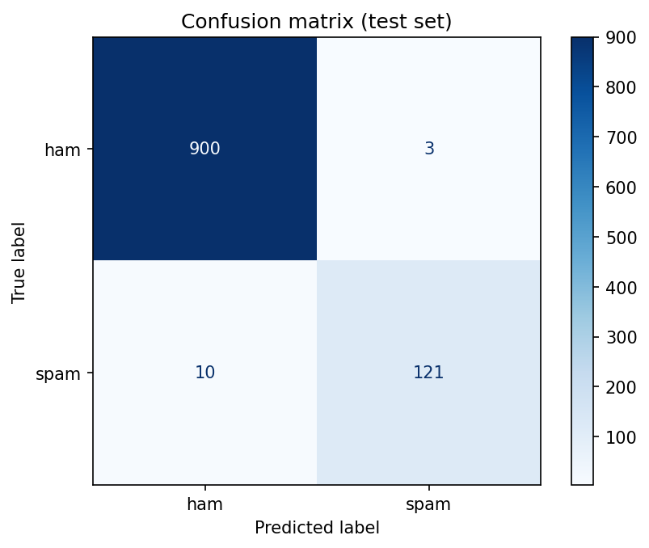
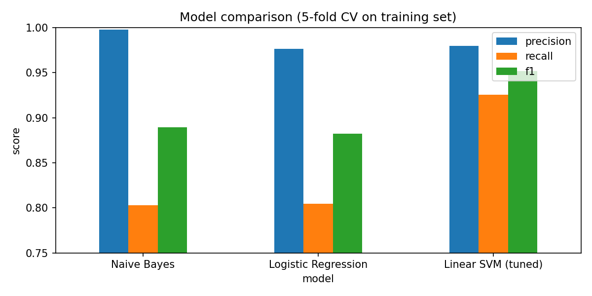

# SMS Spam Classification using SVM (Improved)

**Author:** Md Eftha Kharul Haque Efath 
**Course:** ICE-4108 Artificial Intelligence Lab, Dept. of ICE, BUP
Based on the lab notebook provided by XXXX.

## Results (test set, 1034 messages)

| Metric | Original notebook | Improved |
|---|---|---|
| Accuracy | 0.9845 | **0.9874** |
| Spam Precision | 0.9832 | 0.9758 |
| Spam Recall | 0.8931 | **0.9237** |
| Spam F1 | 0.9360 | **0.9490** |
| Missed spam (of 131) | 14 | **10** |
| Real messages blocked (of 903) | 2 | 3 |

## What was improved
1. **Smarter preprocessing:** URLs, emails, money amounts, phone numbers and other numbers are replaced with placeholder tokens instead of being deleted. `phonetoken` appears in 72.9% of spam but only 0.1% of ham.
2. **Custom stopword list:** NLTK's list removes strong spam words like "won", "now", "only" and "off", so these are kept.
3. **Lemmatizer fix:** verb-then-noun lemmatization ("lives" → "live", not "life").
4. **Class imbalance tested:** `class_weight='balanced'` caught 4 more spam but blocked 17 more real messages, so it was rejected.
5. **Wider hyperparameter search:** 120 combinations with F1 scoring (not accuracy) and stratified 5-fold CV.
6. **Model comparison:** Naive Bayes and Logistic Regression vs SVM on the same folds.
7. **Fair evaluation:** all decisions made with cross-validation on the training set; the test set was used once at the end.
8. **Reproducible:** fixed random seed, no manual upload needed when `data/spam.csv` is present.

## Model comparison (5-fold CV on training set)

| Model | Precision | Recall | F1 |
|---|---|---|---|
| Naive Bayes | 0.9976 | 0.8027 | 0.8896 |
| Logistic Regression | 0.9767 | 0.8046 | 0.8824 |
| **Linear SVM** | 0.9797 | **0.9253** | **0.9517** |

## Key lesson
Better features gave the biggest improvement. Hyperparameter tuning gave only +0.0017 F1, which is smaller than the fold-to-fold variation (0.0135).

## How to run
1. `pip install -r requirements.txt`
2. Open `SMS_Spam_SVM.ipynb` and run all cells.

## Dataset
[SMS Spam Collection](https://www.kaggle.com/datasets/uciml/sms-spam-collection-dataset) (UCI Machine Learning Repository, Almeida & Hidalgo).

## Future work
Tune Logistic Regression, try character n-grams, and analyse the misclassified messages.
